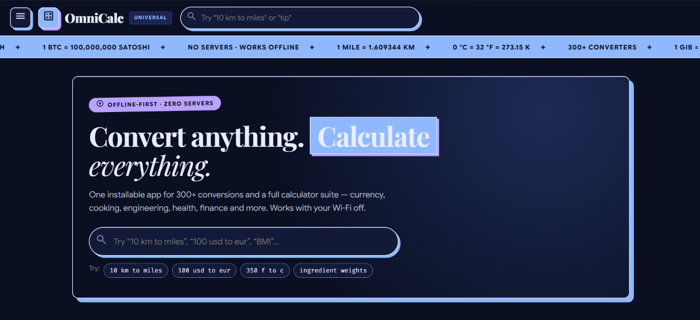

<div align="center">

# 🧮 OmniCalc

### The Universal Calculator & Converter

**7 calculators · 32 converter categories · 300+ units · 120+ currencies · ~50 coins**

*Everything runs in your browser. Nothing is uploaded. It works with your Wi-Fi off.*

[](https://neon-glitch-esc.github.io/omnicalc/)


<br>

<a href="assets/images/WebApp.png"></a>

<sub><i>One search box converts anything — the sidebar holds every tool.</i></sub>

**[▶ Open the live app](https://neon-glitch-esc.github.io/omnicalc/)** — hosted on GitHub Pages, nothing to install

</div>

---

## ✨ What is this?

**OmniCalc** is a single-page web app written in **pure HTML5 + CSS3 + vanilla JavaScript** — no frameworks, no backend, no build step, no `npm install`. Open the [live app](https://neon-glitch-esc.github.io/omnicalc/) or `index.html` and it just works; served over http(s) it becomes a complete **offline PWA** you can install on your desktop or phone.

> **One tab. Every calculation.** Standard & scientific math, programmer bases, graphs, matrices, loans, dates — and 300+ units of measure across 32 categories.

| | | |
|---|---|---|
| 🧮 **7 calculators** — everyday math to finance | 🔄 **32 converter categories** — 300+ units | 🌐 **Live rates** — fiat, crypto, metals |
| 🔍 **Universal search** — natural language | 📴 **Works offline** — install once, use anywhere | 🔒 **Private** — no accounts, no analytics |

---

## 🚀 Quick start

| Way | How | Best for |
|---|---|---|
| **Just open it** | **[neon-glitch-esc.github.io/omnicalc](https://neon-glitch-esc.github.io/omnicalc/)** | Trying it in 2 seconds — full app, installable as a PWA |
| **Double-click** | Open `index.html` | Fully local — everything except the service worker runs from `file://` |
| **Static server** | `npx serve .` or `python -m http.server 8080` | The full PWA locally (the service worker needs http) |
| **VS Code** | *Live Server* extension → Go Live | Development |

Then, in Chrome or Edge, open the live site (or any http(s) copy) and click the **install icon in the address bar** to add OmniCalc to your desktop or home screen. Installed, it launches like a native app and keeps working with no network.

### 🔍 Try typing this

| You type | You get |
|---|---|
| `10 km to miles` | 6.2137 miles |
| `100 usd to eur` | Live exchange rate conversion |
| `350 f to c` | 176.667 °C |
| `2 GiB to MB` | Binary vs decimal storage, handled correctly |
| `1 cup flour in grams` | ≈ 120 g (ingredient densities built in) |
| `bmi` | Jumps straight to the Health calculator |

---

## 🧮 Calculators

| Calculator | What it does | Highlights |
|---|---|---|
| **Standard** | Everyday arithmetic | Memory keys, history tape (tap to reuse · Clear button), full keyboard support |
| **Scientific** | Trig, logs, powers, combinatorics | DEG / RAD / GRAD, nCr / nPr, factorials, constants, `Ans` — shunting-yard parser, **no `eval()`** |
| **Programmer** | Base conversion + bitwise math | BIN / OCT / DEC / HEX, 8 / 16 / 32 / 64-bit two's complement via **BigInt** |
| **Graphing** | Function plotting | Canvas with pan & zoom, up to 3 curves, value table |
| **Matrix** | Linear algebra | Determinant, inverse, `Ax = b`, transpose |
| **Financial** | Money math | EMI + amortization (CSV export), compound interest + chart, simple interest, tip, tax/VAT, discount & markup, ROI, break-even |
| **Date & Time** | Time math | Difference, age, add/subtract, **live countdown**, work-days, world clock |

## 🔄 Converters

| Category | Examples |
|---|---|
| **Length & Distance** | meters, feet, miles, nautical miles, light-years, parsecs |
| **Weight & Mass** | grams, pounds, ounces, stones, carats, tonnes |
| **Volume & Capacity** | liters, gallons, cups, tablespoons, barrels |
| **Area** | m², acres, hectares, sq ft, barns |
| **Temperature** | °C, °F, K, Rankine, Réaumur, Delisle, Newton |
| **Speed** | km/h, mph, knots, m/s, Mach |
| **Fuel economy** | mpg (US/UK), L/100 km, km/L |
| **Pressure · Energy · Power** | Pa, bar, psi, atm · joules, kcal, kWh, BTU · watts, hp (mech/metric/electrical), dBm |
| **Force · Torque · Flow** | newtons, lbf, dynes · N·m, lbf·ft · m³/s, CFM, GPM |
| **Viscosity** | dynamic (Pa·s, P, cP) + kinematic (m²/s, St, cSt) |
| **Digital storage & transfer** | bytes → yottabytes (**1000 vs 1024**), bps → Gbps |
| **Screen & typography** | px, pt, em, rem, mm (CSS 96 dpi) |
| **Angle · Radiation** | degrees, radians, gradians, turns · sievert, gray, rem, becquerel, curie |
| **Health** | BMI, BMR, TDEE, body fat, ideal weight, water intake |
| **Cooking** | ingredient densities, oven marks, recipe scaler |
| **Apparel sizing** | shoes, shirts, rings (US / EU / UK / JP / cm) |
| **Currency & crypto** | 120+ fiat, ~50 coins, precious metals, pre-Euro at **exact legal rates** |
| **Historic & obscure** | cubit, smoot, shaku, li, verst, span… |
| **Number systems & encoding** | base-N (2–36), Roman numerals, Unicode, Base64, Morse |
| **Custom** | Build your own formula converter |

---

## 🌐 Live data, with graceful offline fallback

- **Fiat currency** (120+ codes) — three-provider chain: exchangerate-api → jsDelivr currency-api → frankfurter.app. Cached 1 hour, then bundled reference values.
- **Crypto** (~50 coins) — CoinGecko public API, cached.
- **Precious metals** — editable reference prices.
- **Pre-Euro currencies** — the exact irrevocable fixed rates.

Whatever the network does, the UI always tells you what you're looking at — *live*, *cached X ago*, or *offline reference*.

## 🔒 Private by design

Favorites, history, custom converters and settings live only in your browser's `localStorage`. No account, no analytics, no server — export/import everything as JSON in **Settings**, or wipe it all with one click.

---

## 🎨 Design

- Dark-only **cold "Monet" palette** — deep indigo surfaces, light-blue accents, violet highlights — with bold editorial typography (Playfair Display / Google Sans / Fira Code) and hard offset shadows.
- **Material Symbols** icons, locally subsetted to **88 KB** — the icons work offline too.
- Responsive: fixed sidebar with a **desktop collapse toggle** + **off-canvas drawer** on mobile.

## 🧪 Tests

**43 assertions, zero dependencies** — covering the expression parser, every conversion family (against reference values), number systems, live-data parsers, search parsing and data integrity.

| Runner | Command |
|---|---|
| Browser | Open `tests.html` |
| Node | `node tools/run-tests.js` |
| Layout audit | Open `tools/debug-layout.html` — checks every page for overflow at phone widths |

## ☁️ Hosting

OmniCalc is a **static site** — push to `main` and GitHub Actions (`.github/workflows/static.yml`) deploys the whole folder to **GitHub Pages** automatically. The [live demo](https://neon-glitch-esc.github.io/omnicalc/) is exactly that deployment. Any static host (Netlify, Cloudflare Pages, a plain web server) works the same way: upload the folder, done.

## 📁 Project structure

```text
index.html                 app shell (header · ticker · sidebar · footer)
manifest.json · sw.js      PWA manifest + offline service worker
CHANGELOG.md · LICENSE     version history · MIT
.github/workflows/         auto-deploy to GitHub Pages on push to main
css/                       design tokens, layout, components, responsive, fonts
js/
  app.js · router.js · store.js · utils.js · expr.js · search.js · components.js
  icons.js                 generated Material Symbols codepoint map
  data/                    unit tables, currency/crypto seeds, culinary, apparel
  converters/              generic engine · live rates · custom builder
  tools/                   number systems · health · culinary · apparel
  calculators/             standard, scientific, programmer, graphing, matrix, financial, datetime
  pages/                   home · settings
assets/                    fonts (icons) · icons (PWA) · images (screenshots)
tools/                     icon-font generator · Node test runner · layout audit
```

## ⚠️ Known limits

- The pro unlock is an **honor-system stub** (client-side format check) — see *Settings → Pro*.
- Public rate APIs are rate-limited: the app caches for 1 hour and falls back across three fiat providers before using bundled values.
- Historical units and sizing charts are common-reference approximations (documented inline).
- An inflation calculator is left for a future release (needs a bundled CPI dataset).

## 📜 Version history

See **[CHANGELOG.md](CHANGELOG.md)** — latest: **v1.1.1**.

## 📄 License

MIT © [neon-glitch-ESC](https://github.com/neon-glitch-ESC) — see [LICENSE](LICENSE).

<sub>Data sources: NIST/ISO conversion factors · exchangerate-api (open endpoint) with jsDelivr currency-api and frankfurter.app fallbacks · CoinGecko for crypto · USDA-style ingredient densities · official Euro fixed conversion rates.</sub>
